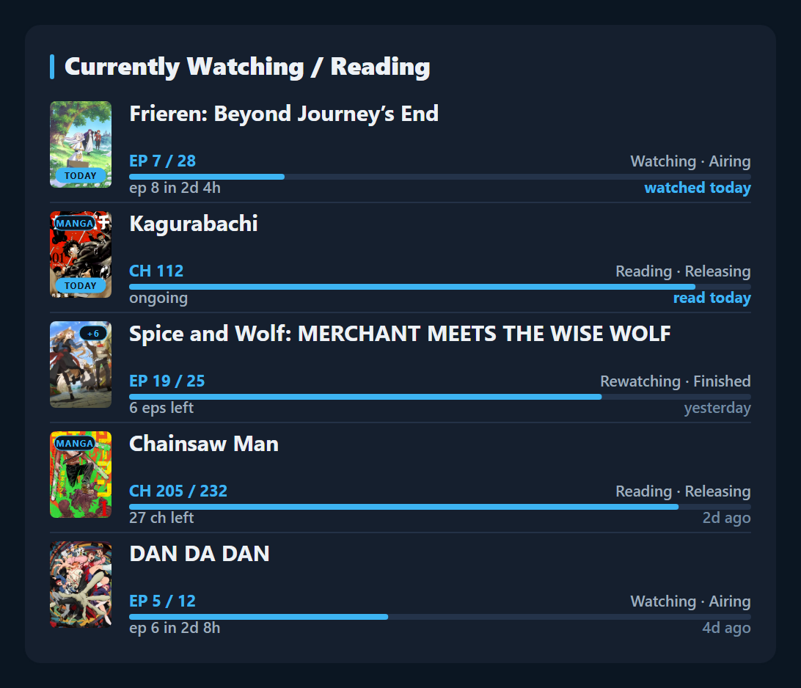
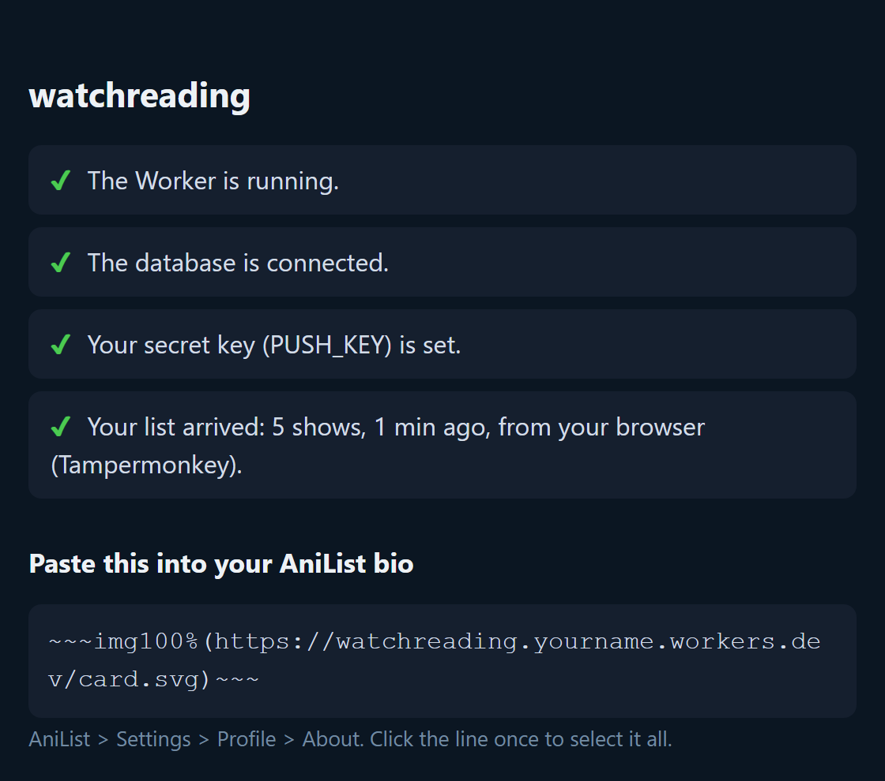
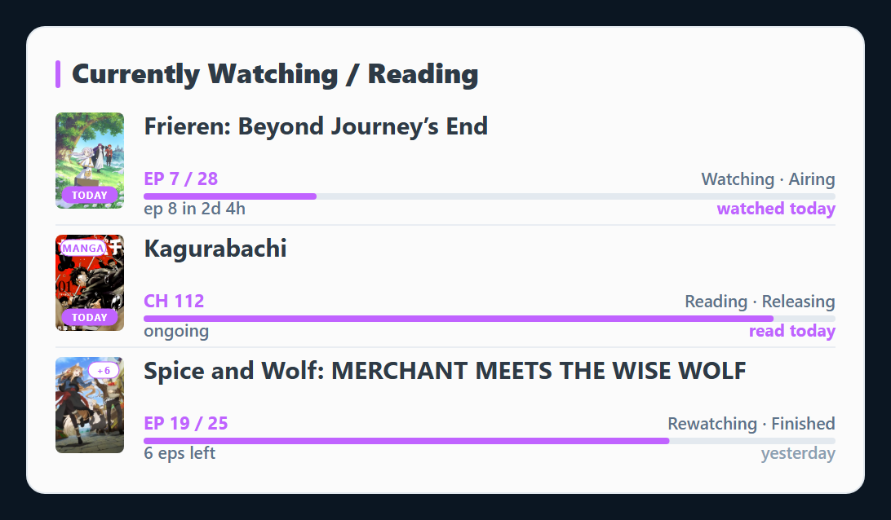

# watchreading

**A "Currently Watching / Reading" card for your AniList bio that updates itself.**

Mark an episode or a chapter on AniList, and a few seconds later your bio shows it.

<p align="center"></p>

What the card shows:

- your **5 latest** anime (Watching / Rewatching) and manga (Reading / Rereading), newest first.
  Planning, Paused, Dropped and Completed are never shown;
- the episode or chapter you're on, with a progress bar;
- a **countdown** to the next episode;
- a **TODAY** badge on what you watched or read today;
- **+3** on a cover when 3 aired episodes are still unwatched;
- all of it in **your AniList profile colour**. Change the colour on AniList and the card follows.

It's **free**, needs **no coding**, and takes about **20 minutes**, once. You only click, copy and paste.

> Everything runs on **your own free accounts**. You make your own card, with your own key.
> Nothing goes through anyone else's account, and nobody else can change your card.

---

## What you need

| | What it's for |
|---|---|
| Your **AniList** account | the list the card shows |
| A free **Cloudflare** account ([sign up](https://dash.cloudflare.com/sign-up)) | where your card lives |
| A computer browser with the free **Tampermonkey** extension | updates the card **instantly** whenever you change your list |
| A free **GitHub** account *(optional, recommended)* | updates the card every 30 minutes, even when your computer is off or you use the AniList phone app |

## How it works, in one picture

```
                    your AniList list
                   │                 │
   instantly,      ▼                 ▼   every 30 minutes,
   from your       Tampermonkey      GitHub   even when
   browser         │                 │        your PC is off
                   └────────┬────────┘
                            ▼
                 your card on Cloudflare
                            │
                            ▼
                    your AniList bio
```

**Why can't the card just read AniList by itself?** AniList blocks Cloudflare's servers.
So your browser and GitHub read your list and *bring* it to your card.
[More details at the bottom.](#how-it-works-the-details)

---

## Step 1: Make your card on Cloudflare (about 10 minutes)

Cloudflare sometimes renames its buttons a little. If a name doesn't match exactly, click the one that's closest.

**1.1 Log in** at [dash.cloudflare.com](https://dash.cloudflare.com) (or sign up; it's free).

**1.2 Make the database** (this is where the card keeps your list):

1. In the menu on the left, click **Storage & databases → D1 SQL database**.
2. Click **Create Database**.
3. Name it `watchreading` and click **Create**.

**1.3 Make the card itself** (a "Worker"):

1. In the menu on the left, click **Compute → Workers & Pages**.
2. Click **Create application**, then **Start with Hello World!** → **Get started**.
3. Name it `watchreading` and click **Deploy**.
   If Cloudflare asks you to choose a `workers.dev` subdomain, type any name you like (for example, your AniList name).

**1.4 Put the card's code in:**

1. On your Worker's page, click **Edit code** (the **`</>`** icon, top right).
2. In the editor, select everything (**Ctrl + A**, or **Cmd + A** on a Mac) and delete it.
3. Open [**worker.js**](worker.js) in a new tab. Click the **Copy raw file** button
   (the two-squares icon at the top right of the file).
4. Paste it into the empty editor and click **Deploy**.

**1.5 Connect the database to the card:**

1. Go back to your Worker's page and open the **Bindings** tab.
2. Click **Add binding** → **D1 database** → **Add binding**.
3. For **Variable name** type `DB` (capital letters). For the database, choose `watchreading`.
4. Click **Add binding**.

**1.6 Open your card's check page.** At the top of your Worker's page is your card's address, something like
`https://watchreading.yourname.workers.dev`. Click it. You'll see a checklist like this:

<p align="center"></p>

The **secret key** line will still be red, with a **ready-made key** in yellow.
**Copy that key into a note** (Notepad, Notes …). You'll paste it 2–3 more times.
(You can also make up your own: 20+ random letters and numbers. **Never** use your AniList password.)

**1.7 Give the card your key:**

1. On your Worker's page, open **Settings**.
2. Under **Variables and Secrets**, click **Add**.
3. Set **Type** to **Secret**, **Variable name** to `PUSH_KEY`, and paste your key into **Value**.
4. Click **Deploy**.

**1.8 Reload the check page.** The first three lines are now green ✔.
The last line ("Your list has not arrived yet") turns green in step 2.

---

## Step 2: Tampermonkey, for instant updates (about 5 minutes)

1. Install **Tampermonkey** from [tampermonkey.net](https://www.tampermonkey.net/). It works in Chrome, Edge, Brave, Firefox, Opera and Safari.
2. **Chrome / Edge / Brave only:** the browser has to allow user scripts.
   - Right-click the Tampermonkey icon → **Manage extension**, and turn on **Allow User Scripts**.
   - If you don't see that switch, turn on **Developer mode** (top right of the extensions page) instead.
3. Click this link: **[Install the watchreading script](../../raw/main/userscript/watchreading.user.js)**.
   Tampermonkey opens a page about the script. Click **Install**.
4. Open [anilist.co](https://anilist.co). After 2 seconds, three small boxes ask you for:
   - your card's address (from step 1.6);
   - your key;
   - your AniList user name.
5. A message says **"watchreading is set up"**.
   If Tampermonkey asks whether the script may connect to your `workers.dev` address, click **Always allow domain**.
6. Reload your check page: all four lines are green ✔.

From now on, whenever you change your list on AniList, the card follows about 2 seconds later.
This works in any AniList tab, even one in the background.

*Need to change something later?* Click the Tampermonkey icon → **watchreading: settings**.
**watchreading: send now** sends your list right away.

---

## Step 3: Put the card in your bio (1 minute)

1. Copy the line under **"Paste this into your AniList bio"** on your check page. It looks like this:
   ```
   ~~~img100%(https://watchreading.yourname.workers.dev/card.svg)~~~
   ```
2. On AniList, go to **Settings → Profile → About**. Paste the line where you want the card, and click **Save**.

Done! 🎉

---

## Step 4: GitHub, so it also updates when your PC is off (about 5 minutes, recommended)

Tampermonkey only works while AniList is open in your computer's browser. GitHub can check your list every 30 minutes on its own.
That way the card also catches changes you make on your phone, or while your computer is off.

1. Sign up at [github.com](https://github.com/signup), if you haven't already.
2. At the top of **this** page, click **Use this template → Create a new repository**.
   - Give it any name (e.g. `my-anilist-card`).
   - Choose **Public**. It's free and unlimited. Your key stays hidden either way.
     (Private works too, but it uses about 1,500 of your 2,000 free minutes a month.)
   - Click **Create repository**. This is **your own copy**.
3. In **your copy**, click **Settings → Secrets and variables → Actions**, then **New repository secret**.
   Add these three secrets, one at a time:

   | Name | Secret |
   |---|---|
   | `ANILIST_USER` | your AniList user name |
   | `CARD_URL` | your card's address, e.g. `https://watchreading.yourname.workers.dev` |
   | `PUSH_KEY` | your key (exactly the same as in step 1.7) |

4. Open the **Actions** tab. If GitHub asks, click **I understand my workflows, go ahead and enable them**.
5. On the left, click **watchreading sync**, then **Run workflow** → **Run workflow**.
   After about a minute, a **green tick ✔** appears.

That's it. GitHub now does this by itself every 30 minutes.

---

## Change how the card looks (optional)

**For one picture:** add options to the end of the address in your bio:

| Add this | What it does |
|---|---|
| `?rows=7` | show 7 shows (1 to 10) |
| `?only=anime` or `?only=manga` | only anime, or only manga |
| `?theme=light` | light card |
| `?accent=ff6b9d` | a fixed colour instead of your profile colour |

To combine options, join them with `&`, for example:
`~~~img100%(https://watchreading.yourname.workers.dev/card.svg?rows=3&only=manga)~~~`

<p align="center"></p>

**For every picture:** on your Worker's page, go to **Settings → Variables and Secrets → Add** and choose **Type: Text**:

| Variable name | Value |
|---|---|
| `ROWS` | `1` to `10` (default `5`) |
| `THEME` | `dark` (default) or `light` |
| `ACCENT` | `profile` (default: your AniList profile colour) or a colour like `#3db4f2` |
| `HEADING` | the title at the top (default `Currently Watching / Reading`) |
| `TIMEZONE` | e.g. `Europe/London`. Normally not needed: Tampermonkey sends your time zone. Set it if you only use GitHub. |

---

## Something's not working?

**First, open your check page** (your card's address, without `/card.svg`). Any red ✘ line says what's missing.

| What you see | What to do |
|---|---|
| The card says **"Waiting for the first update from AniList"** | Nothing has been sent yet. Open AniList with Tampermonkey turned on, or run the GitHub job (step 4.5). |
| **"wrong key"** (in Tampermonkey's message or in the GitHub job) | The key has to be exactly the same in Cloudflare, Tampermonkey and GitHub, with no extra spaces. |
| No setup boxes on AniList | Check that Tampermonkey is on, **Allow User Scripts** is on (step 2.2) and the script is turned on in Tampermonkey. Then click the Tampermonkey icon → **watchreading: settings**. |
| The GitHub job has a **red ✘** | Click it and open **Send the list to the card**. The message says what's wrong: a missing secret, the wrong key, or the wrong AniList name. |
| A cover shows as an empty box | It arrives with the next update (each cover is sent once). |
| The bio still shows the old card | Reload the AniList page. The card itself is always up to date. |
| "TODAY" shows on the wrong day | Set the `TIMEZONE` variable (see above). |

---

## How it works (the details)

For the curious. You don't need this part to set it up.

- **AniList blocks Cloudflare.** If a Cloudflare Worker asks AniList for a list, AniList answers *"403 – manually blocked"*.
  The same happens for AniList's cover pictures. So the card **never contacts AniList**. Instead, your list is **pushed** to it.
- **Your card** is a small program (a Cloudflare *Worker*, [`worker.js`](worker.js)) with a small database (*D1*).
  - It stores your latest list and the covers.
  - It draws the card **fresh every time someone views it**, so the countdowns are always right.
  - It tells browsers never to keep an old copy.
- **Covers are inside the picture.** A picture in a bio isn't allowed to load other pictures from the internet.
  So each cover is stored by the card and put inside it. Because the card can't download covers either (blocked), the senders upload each cover once.
- **The Tampermonkey script** ([`userscript/watchreading.user.js`](userscript/watchreading.user.js)) runs on AniList pages in your browser:
  - It notices the moment AniList **saves a change** to your list (the +1 button, the list editor, anything) and sends your list about 2 seconds later.
  - It also **checks every minute** in any open AniList tab, including tabs in the background. That way it catches changes made on another device.
  - It only sends when something changed, plus once every 30 minutes anyway.
  - If you have several AniList tabs open, they take turns, so your list isn't sent twice.
  - It also sends your **profile colour** (and notices when you change it) and your **time zone** (for the TODAY badge).
  - Your settings are kept by Tampermonkey.
- **The GitHub job** ([`.github/workflows/watchreading-sync.yml`](.github/workflows/watchreading-sync.yml) running [`sync/sync.mjs`](sync/sync.mjs)) does the same reading and sending every 30 minutes on GitHub's computers.
  GitHub pauses timed jobs in projects that see no activity for 60 days, so the job tells GitHub once a day that it's still wanted.
- **The key** only lets someone update **your card's list**, nothing else.
  - It lives as a secret in Cloudflare and GitHub, and in Tampermonkey's storage.
  - The card never needs your AniList password: it only reads your **public** list.
- **Cost:** nothing.
  - Cloudflare's free plan allows 100,000 card views a day.
  - GitHub's timed jobs are free and unlimited for public projects.

## The files

| File | What it is |
|---|---|
| [`worker.js`](worker.js) | the card (paste into Cloudflare, step 1.4) |
| [`userscript/watchreading.user.js`](userscript/watchreading.user.js) | the Tampermonkey script (step 2) |
| [`.github/workflows/watchreading-sync.yml`](.github/workflows/watchreading-sync.yml), [`sync/sync.mjs`](sync/sync.mjs) | the GitHub job (step 4) |
| [`wrangler.toml`](wrangler.toml) | only for people who prefer Cloudflare's command-line tool instead of the website (instructions inside) |

Not affiliated with AniList, Cloudflare or GitHub. MIT licence.
